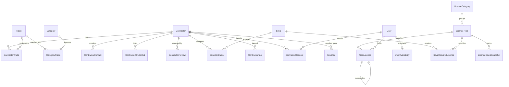

# Data Model Documentation: Seva Maintenance System

## 1. Overview & Conventions

All persistent entities are managed using Prisma ORM with PostgreSQL 16.
- **Identifiers**: Cryptographic UUID v4 for all primary keys.
- **Naming Conventions**: PascalCase in TypeScript / Prisma; `snake_case` in database tables and columns via `@@map` and `@map`.
- **Timestamps**: All dates are stored as UTC timestamps (`TIMESTAMP WITH TIME ZONE`).
- **Optimistic Concurrency**: Optimistic concurrency control (`version` integer field) protects `Seva` and `Occurrence` updates against concurrent overwrite conflicts.

---

## 2. Entity Relational Diagram & Schema Overview

---

## 3. Core Entities

### 3.1. Authentication & RBAC

#### `User` (`users`)
- `id`: UUID (PK)
- `name`: String
- `email`: String (Unique, Nullable)
- `phone`: String (Unique, Nullable)
- `passwordHash`: String (Argon2id or bcrypt cost 12)
- `roleId`: UUID (FK -> Role)
- `isActive`: Boolean (Default: true)
- `mustChangePassword`: Boolean (Default: false)
- `lastLoginAt`: DateTime (Nullable)

#### `Role` (`roles`) & `RolePermission` (`role_permissions`)
- System roles: `ADMIN`, `COORDINATOR`, `MEMBER`.
- Permissions stored as granular string capability keys (e.g. `seva.read`, `quotes.manage`).

#### `Session` (`sessions`)
- Server-side revocable session storage.
- `tokenHash`: SHA-256 hash of 256-bit crypto session token (raw token stored only in HTTP-only cookie).
- `lastSeenAt`: DateTime (12h idle timeout).
- `expiresAt`: DateTime (7d absolute lifetime).

---

### 3.2. Masters

#### `Category` (`categories`)
- Administrative classification: AC, Flooring, Landscaping, Networking, etc.

#### `Area` (`areas`)
- Self-referencing tree structure representing location hierarchy:
  `Building -> Floor -> Room -> Outdoor area`.

#### `Tag` (`tags`) & `SevaTag` (`seva_tags`)
- Freeform categorization tags assigned to tasks.

---

### 3.3. Seva (Task) & Hierarchy

#### `Seva` (`sevas`)
- `code`: Human-readable identifier (`SEV-0001`, sequential, immutable).
- `title`: String (1 to 255 chars).
- `description`: Text (up to 5,000 characters).
- `kind`: Enum (`ONE_TIME` | `RECURRING`).
- `subKind`: Enum (`NEW` | `REPAIR`, for one-time seva).
- `priority`: Enum (`LOW` | `MEDIUM` | `HIGH` | `URGENT`).
- `scheduleMode`: Enum (`FIXED` | `FLOATING`).
- `requiresVerification`: Boolean.
- `estimatedBudget`: Decimal (Optional).
- `approvedBudget`: Decimal (Set automatically upon quote approval).
- `parentId`: UUID (FK to parent Seva, `ON DELETE RESTRICT`).
- `isGroup`: Boolean (true if container for child sub-sevas).
- `path`: Text materialized path (`/<rootId>/.../<id>/`).
- `depth`: Integer (0 to 12).
- `sortOrder`: Integer.
- `version`: Integer (Optimistic locking counter).
- `isArchived`: Boolean.

#### `RecurrenceRule` (`recurrence_rules`)
- Schedule specification for recurring seva.
- `frequency`: Enum (`DAILY` | `WEEKLY` | `MONTHLY` | `QUARTERLY` | `YEARLY` | `EVERY_N_DAYS`).
- `interval`: Integer (Step count).
- `byWeekday`: Integer array (1=Mon ... 7=Sun).
- `byMonthDay`: Integer array (1..31).
- `startDate`: Date.
- `endDate`: Date (Optional).

#### `Occurrence` (`occurrences`)
- Individual work visit or instance of a Seva.
- Unique constraint: `(sevaId, dueDate)`.
- `status`: Enum (`PENDING` | `IN_PROGRESS` | `NEEDS_VERIFICATION` | `DONE` | `SKIPPED` | `CANCELLED`).
- `dueDate`: DateTime (UTC).
- `completedAt`: DateTime (Nullable).
- `completedById`: UUID (FK -> User).
- `completionNote`: Text (Nullable).
- `skipReason`: Text (Nullable).
- `actualCost`: Decimal (Nullable).
- `version`: Integer (Optimistic locking counter).

---

### 3.4. File & Media System

#### `FileObject` (`file_objects`)
- Shared content-addressed storage entity across all modules.
- `storageKey`: Physical path relative to `./data/uploads`.
- `originalName`: User-supplied filename.
- `mimeType`: Sniffed MIME type from binary magic bytes.
- `sizeBytes`: BigInt.
- `sha256`: Hexadecimal SHA-256 hash.
- `width`: Integer (Nullable, for images).
- `height`: Integer (Nullable, for images).
- `thumbnailKey`: Path to generated 300x300 WebP thumbnail.
- `scanStatus`: Enum (`NOT_SCANNED` | `CLEAN` | `INFECTED`).

#### `SevaFile` (`seva_files`)
- Association between a `Seva` and a `FileObject`.
- `bucket`: Enum (`QUOTE` | `ARTEFACT`).
- **Quotes Metadata**:
  - `supplierName`: String.
  - `amount`: Decimal.
  - `currency`: String (Default: AUD).
  - `quoteStatus`: Enum (`RECEIVED` | `UNDER_REVIEW` | `APPROVED` | `REJECTED`).
  - `approvedById`: UUID.
  - Partial unique index: At most **one APPROVED quote per seva**.
- **Artefacts Metadata**:
  - `artefactType`: Enum (`PHOTO` | `DOCUMENT` | `INVOICE` | `VIDEO` | `OTHER`).
  - `stage`: Enum (`BEFORE` | `AFTER` | `GENERAL`).
  - `occurrenceId`: UUID (Nullable, ties photo to recurring visit).

#### `FileLink` (`file_links`)
- Extensibility link reserved for Phase 2 (Contractors and Licences modules).

---

### 3.5. Audit, Comments, & System

#### `ActivityLog` (`activity_logs`)
- Append-only audit record for all entity modifications.
- Fields: `entityType`, `entityId`, `userId`, `action`, `oldValue`, `newValue`, `createdAt`.

#### `Comment` (`comments`)
- Polymorphic user commentary supporting @mentions.

#### `Notification` (`notifications`) & `Reminder` (`reminders`)
- In-app notification queue and scheduled reminder table with `dedupeKey`.

#### `Setting` (`settings`)
- Key-value JSON store for system configuration.

---

### 3.6. Module: Contractors

#### `Contractor` (`contractors`)
- `id`: UUID (PK).
- `code`: Human-readable identifier (`CON-0001`), unique, immutable.
- `companyName`: Legal entity name.
- `tradingName`: Commercial business name.
- `registrationNumber`: Tax / company ID (e.g., ABN/ACN).
- `registrationType`: Identifier classification (default: `ABN`).
- `gstRegistered`: Boolean (default: true).
- `status`: Enum (`ACTIVE` | `INACTIVE` | `PENDING_APPROVAL` | `BLOCKED`).
- `blockedReason`: Text explanation (restricted tier).
- `isPreferred`: Boolean priority flag.
- `website`, `mainPhone`, `mainEmail`: Contact endpoints.
- `addressLine1`, `addressLine2`, `suburb`, `state`, `postcode`, `country`: Physical location.
- `serviceAreas`: Array of serviced zones.
- `afterHoursAvailable`: Boolean emergency flag.
- `emergencyPhone`: 24/7 hotline.
- `paymentTerms`: Net terms string.
- `callOutFee`, `hourlyRate`: Commercial pricing (restricted tier).
- `internalNotes`: Coordinator internal commentary (restricted tier).
- `version`: Integer for optimistic locking.
- `archivedAt`: Soft-archive timestamp.

#### `Trade` (`trades`) & `ContractorTrade` (`contractor_trades`)
- Admin-managed master taxonomy (e.g. Electrical, Plumbing, HVAC, Roofing).
- M:N mapping with `isPrimary` designation.

#### `CategoryTrade` (`category_trades`)
- Admin-managed taxonomy mapping linking Seva categories to recommended trades.

#### `ContractorContact` (`contractor_contacts`)
- Personnel contacts with partial unique index ensuring exactly one primary contact per contractor.

#### `ContractorCredential` (`contractor_credentials`)
- `kind`: Enum (`LICENCE` | `INSURANCE` | `CERTIFICATION` | `OTHER`).
- `status`: Enum (`VALID` | `EXPIRING_SOON` | `EXPIRED` | `PENDING_VERIFICATION` | `REVOKED`).
- Number and exact dates guarded by `contractors.credentials.view`.

#### `ContractorReview` (`contractor_reviews`)
- Star ratings (1-5), quality, timeliness, and price sub-ratings. Comment text restricted to `contractors.readFull`.

#### `SevaContractor` (`seva_contractors`)
- Task engagement record linking Seva to Contractor with role (`PRIMARY` | `SUBCONTRACTOR` | `CONSULTANT`) and status (`INVITED` | `QUOTED` | `ENGAGED` | `COMPLETED` | `CANCELLED`).
- Financial amounts guarded by `contractors.readFull`.

#### `ContractorRequest` (`contractor_requests`)
- Propose-and-review pipeline. `code` formatted as `CRQ-0001`.
- `type`: Enum (`NEW_CONTRACTOR` | `UPDATE_CONTRACTOR`).
- `proposedData`: Untrusted jsonb payload with snapshot version for optimistic conflict detection.
- `status`: Enum (`OPEN` | `APPROVED` | `PARTIALLY_APPROVED` | `REJECTED` | `WITHDRAWN`).

---

### 3.7. Module: Licences

#### `LicenceCategory` (`licence_categories`)
- `id`: UUID (PK).
- `name`: Unique grouping name (e.g. Plant and Equipment, Working at Heights, Electrical and Trades, First Aid and Safety).
- `sortOrder`: Integer for display ordering.

#### `LicenceType` (`licence_types`)
- `id`: UUID (PK).
- `code`: Unique slug (`forklift`, `ewp`, `white-card`, `first-aid`).
- `name`: Display name.
- `categoryId`: UUID (FK -> LicenceCategory).
- `kind`: Enum (`LICENCE` | `TICKET` | `CERTIFICATE` | `COMPETENCY`).
- `issuer`: Default issuing authority name.
- `aliases`: Text array of search aliases (e.g. `["EWP", "Yellow card", "Boom lift"]`).
- `classes`: Text array of permissible classes (e.g. Forklift: `["LF"]`; EWP: `["under 11m", "over 11m"]`).
- `hasExpiry`: Boolean indicator whether this ticket expires.
- `defaultValidityMonths`: Integer validity window.
- `requiresNumber`: Boolean indicator if ticket requires an identifier.
- `isHighlySensitive`: Boolean privacy flag for personal records (Driver Licence, WWCC, Police Check).
- `minHoldersTarget`: Target minimum number of valid holders desired by organisation.
- `description`: Text summary.
- `isActive`: Boolean active toggle.
- `sortOrder`: Display ordering integer.

#### `UserLicence` (`user_licences`)
- `id`: UUID (PK).
- `userId`: UUID (FK -> User).
- `licenceTypeId`: UUID (FK -> LicenceType).
- `class`: Optional sub-type, validated against type's allowed classes.
- `licenceNumber`: Sensitive identifier string (field-tier guarded, masked `••••• 482` by default).
- `issuer`: Issuing body.
- `issuedAt`: Issue timestamp.
- `expiresAt`: Expiration timestamp (used for status derivation).
- `conditions`: Restriction text.
- `notes`: Commentary.
- `status`: Enum (`PENDING_VERIFICATION` | `VALID` | `EXPIRING_SOON` | `EXPIRED` | `SUSPENDED` | `REVOKED` | `REJECTED` | `SUPERSEDED`).
- `source`: Enum (`ADMIN_ENTERED` | `SELF_SUBMITTED` | `IMPORTED`).
- `verifiedById`: UUID (FK -> User).
- `verifiedAt`: Verification timestamp.
- `rejectionReason`: Text explanation if rejected.
- `supersededById`: UUID (FK -> UserLicence, linking to newer record).
- `archivedAt`: Soft-archive timestamp.
- `version`: Integer for optimistic locking.
- **Partial Unique Index**: `UNIQUE(userId, licenceTypeId, COALESCE(class, '')) WHERE archived_at IS NULL AND superseded_by_id IS NULL`.

#### `UserAvailability` (`user_availabilities`)
- `id`: UUID (PK).
- `userId`: UUID (FK -> User, Unique). Exactly one availability status per user.
- `status`: Enum (`AVAILABLE` | `LIMITED` | `UNAVAILABLE`).
- `note`: Text up to 200 chars (e.g. "Weekends only").
- `availableUntil`: Optional timestamp for auto-reversion back to `AVAILABLE`.

#### `SevaRequiredLicence` (`seva_required_licences`)
- `id`: UUID (PK).
- `sevaId`: UUID (FK -> Seva).
- `licenceTypeId`: UUID (FK -> LicenceType).
- `classRequired`: Optional specific class needed.
- `minHolders`: Integer minimum assignees who must hold the licence (default 1).
- `createdById`: UUID (FK -> User).
- **Unique Constraint**: `UNIQUE(sevaId, licenceTypeId, classRequired)`.

#### `LicenceCountSnapshot` (`licence_count_snapshots`)
- `id`: UUID (PK).
- `takenOn`: Date (without time component).
- `licenceTypeId`: UUID (FK -> LicenceType).
- `validHolders`: Integer count.
- `expiringSoon`: Integer count.
- `expired`: Integer count.
- `pending`: Integer count.
- **Unique Constraint**: `UNIQUE(takenOn, licenceTypeId)`.

